# HaiSan Express

[](https://github.com/anvuhoang/seafood-marketplace-web/actions/workflows/ci.yml)

A marketplace for live seafood. Customers buy from many vendors in **one order**, vendors run their own store and
offers, and admins approve vendors and watch the shop. The site is in Vietnamese; the code and documentation are in
English.

| | |
|---|---|
| **Live demo** | https://haisan.eastasia.cloudapp.azure.com (a student server; it may be switched off outside the demo) |
| **API documentation** | Public Swagger UI at `/api/docs` (OpenAPI at `/api/docs-json`), e.g. <https://haisan.eastasia.cloudapp.azure.com/api/docs> |
| **Documentation** | [Architecture](docs/architecture.md) · [Configuration](docs/configuration.md) · [API](docs/api.md) · [Testing](docs/testing.md) · [Deployment](docs/deployment.md) · [Demo guide](docs/demo-guide.md) · [Demo data](docs/demo-data.md) · [Contributing](docs/contributing.md) |

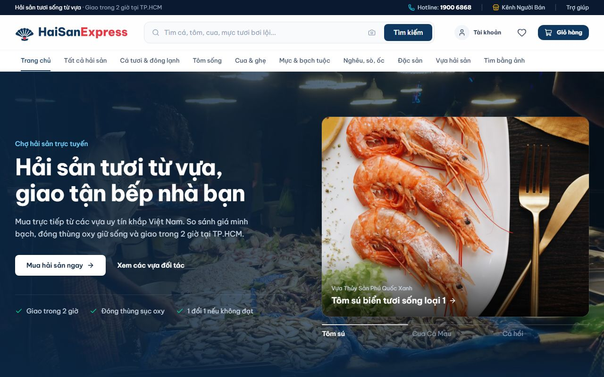

## Contents

1. [What it does](#what-it-does)
2. [Screenshots](#screenshots)
3. [Tech stack](#tech-stack)
4. [How it fits together](#how-it-fits-together)
5. [Quick start](#quick-start)
6. [Demo accounts](#demo-accounts)
7. [Project structure](#project-structure)
8. [Useful commands](#useful-commands)
9. [Testing](#testing)
10. [CI/CD and deployment](#cicd-and-deployment)
11. [Known limits](#known-limits)

## What it does

**Customers**
- Browse and search the catalogue (no accents needed, typos forgiven), filter by category, region, price and stock;
  search by **photo** (Visual Search).
- A cart that works for guests and is merged into the account at sign-in; one checkout can hold products from several
  vendors and is split into **one order part per vendor**, each with its own shipping fee.
- Pay **cash on delivery** or by **QR bank transfer** (PayOS); follow the order, cancel it while every part is still
  pending, buy again, review the products of a delivered order (with photos).
- Sign up with an email and password or **Google**, **forgot password** by email, saved addresses, followed vendors.
- Emails: order confirmation, payment received, shipped, delivered, cancelled, password reset.
- **Cá Voi**, a shopping assistant chatbot: finds products, answers about the customer's own orders and the shop's
  policies, and proposes a cart change that the customer confirms.

**Vendors**
- Apply to open a store; once an admin approves it, manage offers (price, stock, status), products and photos.
- **Smart Import**: describe a product by typing or speaking and get an editable draft.
- Take each order part from pending to delivered (accept, prepare, hand over, complete) or cancel it; dashboard and
  revenue statistics; a public store page.

**Admins**
- Approve, reject, suspend and reactivate vendors (with a recorded reason); read-only list of accounts; manage
  categories; overview statistics and revenue; chatbot monitoring (latency, tokens, budget, incidents, handoffs).

**Platform**
- Role-based access (customer, vendor, admin) checked on the server on every request; sessions that end when the
  password is reset; per-address rate limits; a shared cache; product search in Elasticsearch with a fallback.
- Runs in Docker Compose behind nginx (two API processes) and on a server with HTTPS; GitHub Actions checks every
  change and deploys.

## Screenshots

| Search | Product |
|---|---|
| 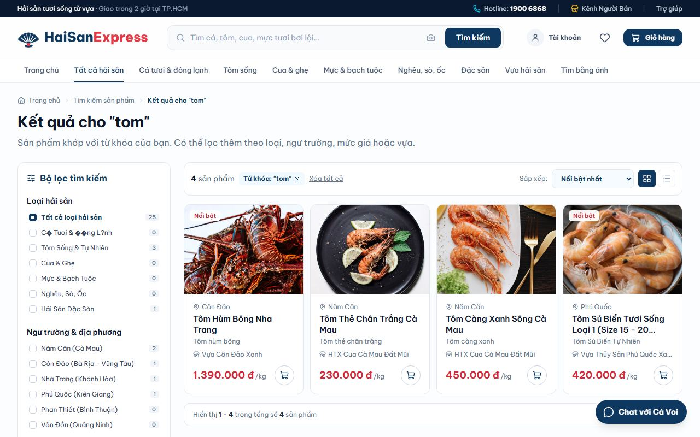 | 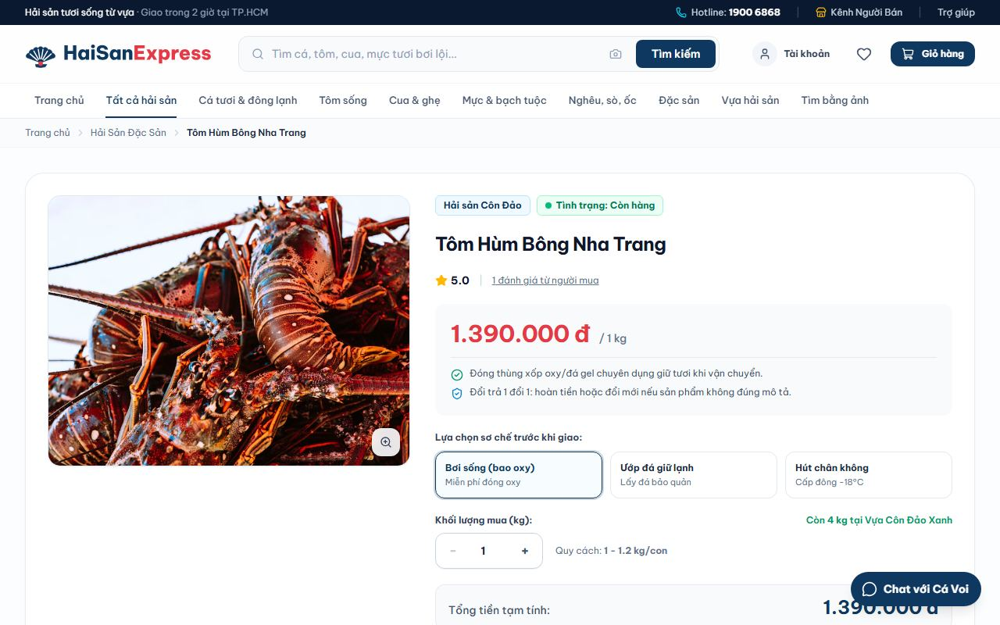 |
| **Cart** | **Checkout** |
| 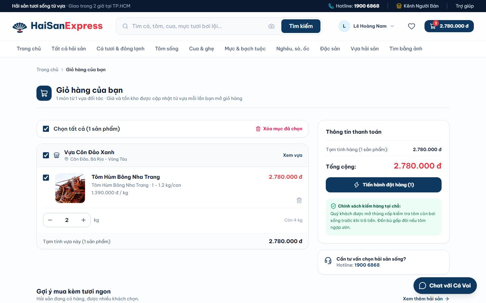 | 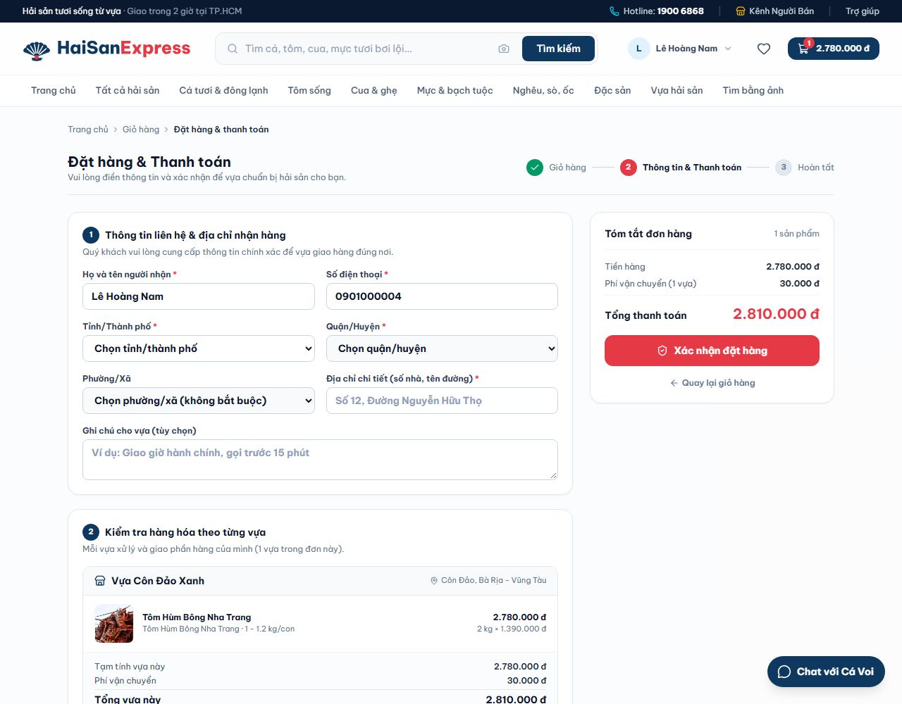 |
| **Order** | **Sign in** |
| 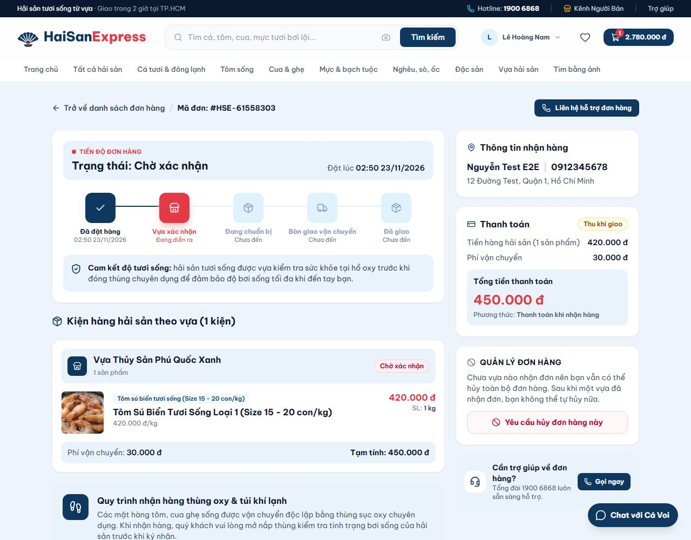 | 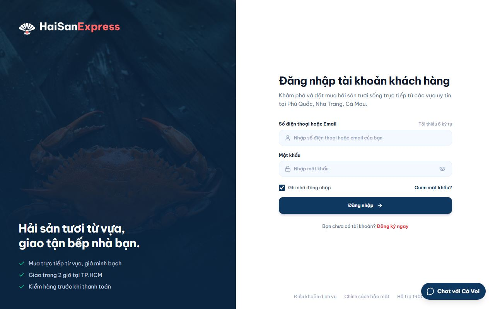 |
| **Vendor dashboard** | **Vendor orders** |
| 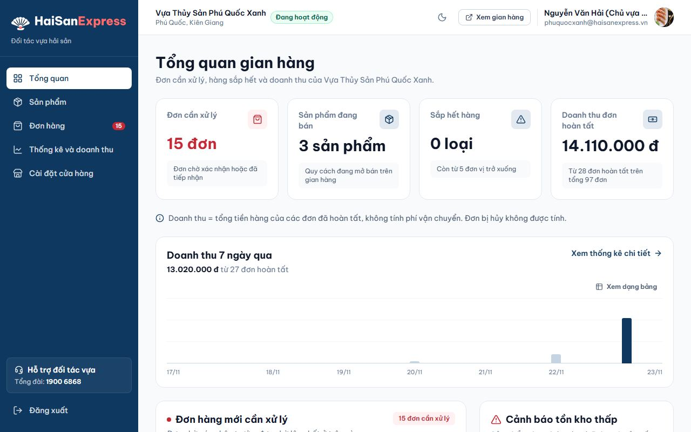 | 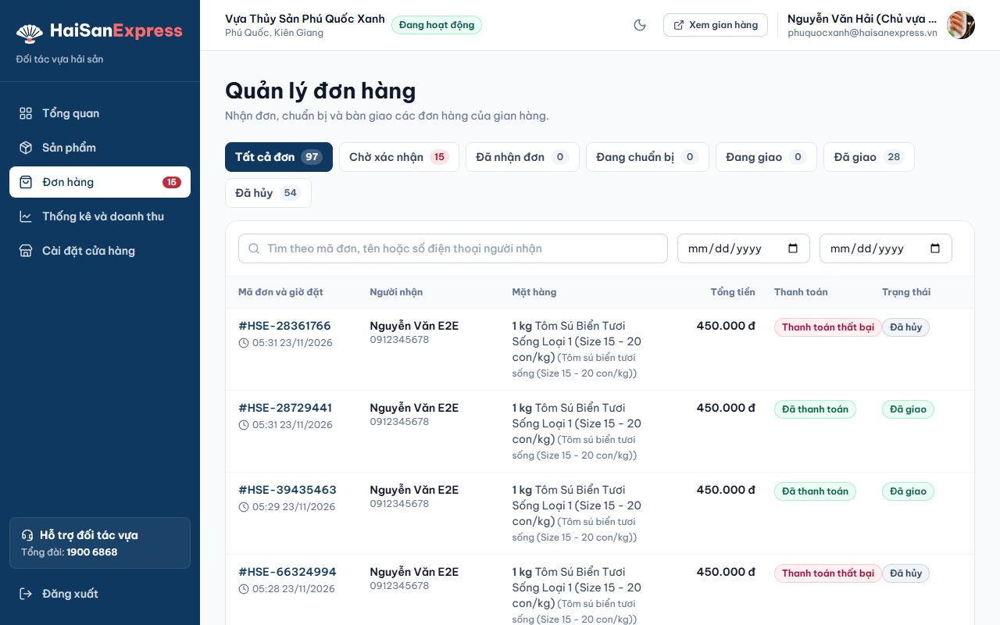 |
| **Admin overview** | **Admin: vendor approval** |
| 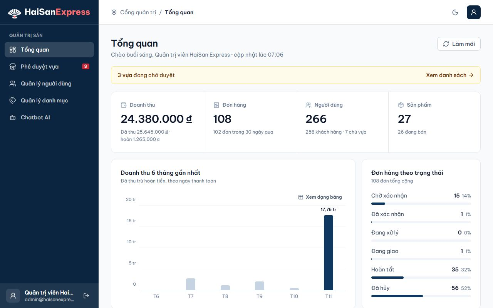 | 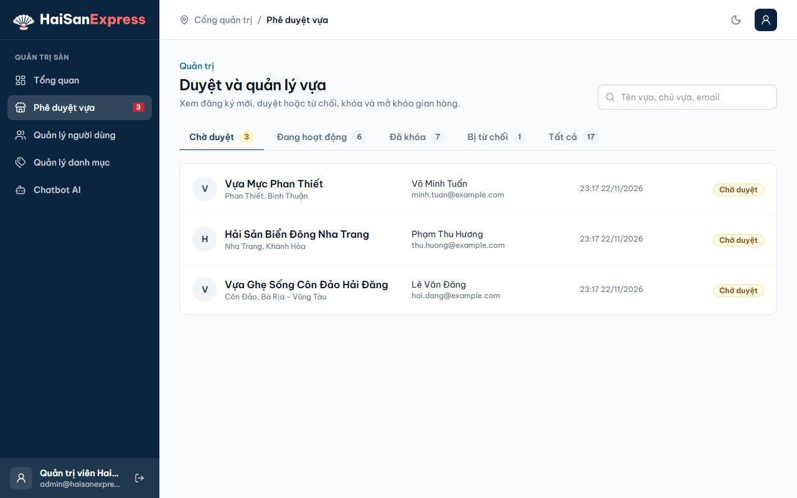 |

On a phone:

| Home | Product | Cart |
|---|---|---|
| 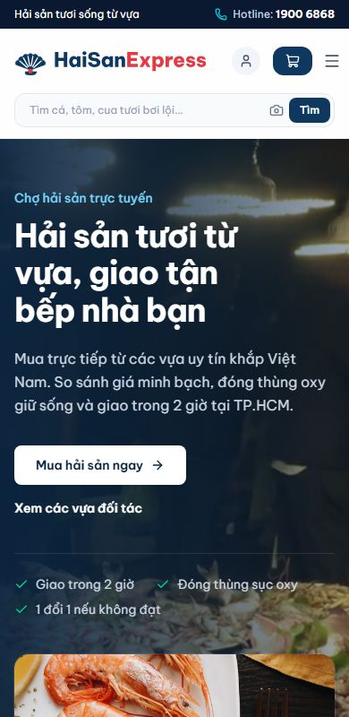 | 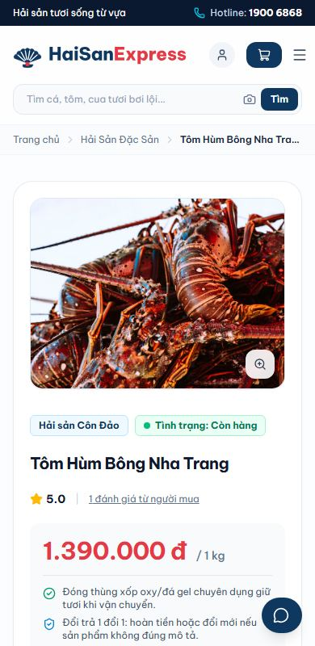 | 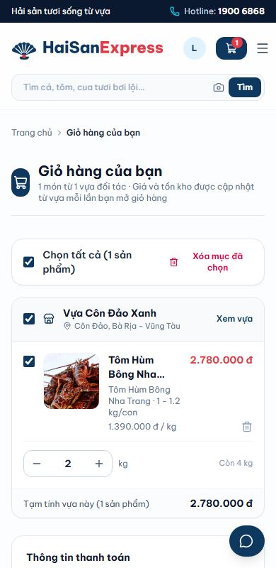 |

## Tech stack

| Layer | Technology |
|---|---|
| Website | Next.js 16 (App Router), React 19, TypeScript, Tailwind CSS 4 |
| API | NestJS 12, TypeScript, class-validator, Swagger (OpenAPI) |
| Database | PostgreSQL 17 with Prisma 7 (schema split in `backend/prisma/schema/`, SQL migrations) |
| Cache and limits | Redis 7 (shared rate limits, cache, session revocation); memory when Redis is absent |
| Search | Elasticsearch 8 (typos, no accents, suggestions) with an in-memory fallback |
| Authentication | JWT, bcrypt, Google Sign-In (ID token), password reset by email |
| Payment | PayOS (QR transfer, signed webhook) and cash on delivery |
| Email | nodemailer over Gmail SMTP (or the API log in development) |
| AI | Gemini or Groq (chatbot), Groq (Smart Import, Visual Search) |
| Images | Cloudinary (direct signed uploads from the browser) |
| Containers | Docker Compose, nginx (load balancer), Caddy (HTTPS on a server) |
| Quality | Vitest (unit), Playwright (end to end), ESLint/oxlint, GitHub Actions |

## How it fits together

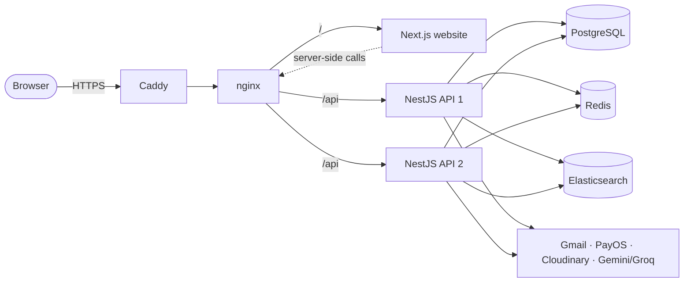

The website and the API are separate programs. nginx is the only front door and spreads API calls over the API
processes; the rate limits and the cache live in Redis, so the processes count together. Details, the data model, the
order and payment lifecycles and the security model are in [docs/architecture.md](docs/architecture.md).

## Quick start

### Everything in containers (like a server)

You need Docker with Compose.

```bash
cp .env.docker.example .env                 # set POSTGRES_PASSWORD and JWT_SECRET
docker compose up --build -d                # the shop at http://localhost:8088
docker compose --profile tools run --rm seed   # sample vendors, products, customers, orders
docker compose --profile tools run --rm seed-demo   # optional: 300 products, 900 orders, reviews (docs/demo-data.md)
```

Open http://localhost:8088. Optional keys (mail, Google, PayOS, chatbot, photos) go in the same `.env`; without
them the shop still works and those features are switched off. See [docs/configuration.md](docs/configuration.md).

### For development (hot reload)

You need Node.js 24 and PostgreSQL 17 (Redis and Elasticsearch are optional).

```bash
# 1. API
cd backend
npm install
cp .env.example .env            # set DATABASE_URL and JWT_SECRET
npm run db:deploy               # create the tables
npm run seed                    # sample data
npm run start:dev               # http://localhost:5000  (Swagger: /api/docs)

# 2. Website (another terminal)
cd frontend
npm install
cp .env.example .env.local      # NEXT_PUBLIC_API_URL=http://localhost:5000/api
npm run dev                     # http://localhost:3000
```

More about the API (migrations, seed data, chatbot, search) in [backend/README.md](backend/README.md) and about the
website in [frontend/README.md](frontend/README.md).

## Demo accounts

Created by the seed (`npm run seed`). All of them are demo data.

| Role | Sign in at | Email | Password |
|---|---|---|---|
| Customer | `/customer/login` | `nam.le@example.com` (also `lan.nguyen@`, `quan.tran@`, `ha.pham@`) | `Customer@123456` |
| Vendor | `/customer/login` (goes to the vendor console) | `phuquocxanh@haisanexpress.vn` (also `nhatrangxanh@`, `duyenhaiphanthiet@`, `condaoxanh@`, `camaudatmui@`, `vandon@`, `halongtamngung@haisanexpress.vn`) | `Vendor@123456` |
| Admin | `/admin/login` | `admin@haisanexpress.vn` | `Admin@123456` |

The demo seed ([docs/demo-data.md](docs/demo-data.md)) adds 12 more stores (owners such as `catbaxanh@haisanexpress.vn`, password `Vendor@123456`) and 120 customers.

Three customers (`hai.dang@example.com` and two more) have a store application waiting for the admin to approve.
Change these passwords before showing the shop to anyone outside a demo.

## Project structure

```
backend/                NestJS API
  src/module/           one folder per feature: auth, account, product, cart, checkout, order, payment,
                        review, vendor, admin, chat, search, smart-import, visual-search, mail ...
  src/common/           guards (JWT, roles, session revocation), decorators
  src/infra/            Redis/memory store, rate limit, cache, health
  prisma/schema/        the data model, split by area; prisma/migrations/ the SQL history; prisma/seed.ts
  knowledge/            help documents for the chatbot (markdown)
frontend/               Next.js website
  src/app/              pages: storefront, /customer, /vendor, /admin
  src/features/         one folder per feature: components, API calls, types
  e2e/                  Playwright end-to-end tests
deploy/                 nginx, Caddy, server setup and deploy scripts
docs/                   documentation and screenshots
.github/workflows/      CI, image publishing, deploy
docker-compose.yml      the whole shop; docker-compose.prod.yml adds Caddy and registry images for a server
```

## Useful commands

| Where | Command | What it does |
|---|---|---|
| `backend` | `npm run start:dev` | API with hot reload |
| `backend` | `npm test` / `npm run lint` / `npm run typecheck` | unit tests, linter, type check |
| `backend` | `npm run db:migrate -- --name <what>` | create and apply a migration after editing the schema |
| `backend` | `npm run db:deploy` | apply the committed migrations (servers, CI) |
| `backend` | `npm run seed` | sample data (safe to run again) |
| `backend` | `npm run seed:demo` | after `seed`: a full-looking shop, 300 products and 900 orders ([demo data](docs/demo-data.md)) |
| `backend` | `npm run search:reindex` | rebuild the Elasticsearch index |
| `backend` | `npm run knowledge:ingest` | embed the chatbot's help documents |
| `backend` | `npm run chat:eval` | ask the chatbot ~30 questions and write a report |
| `frontend` | `npm run dev` / `npm run build` / `npm run lint` | website |
| `frontend` | `npm run e2e` | Playwright tests against a running shop (default `http://localhost:8088`) |
| root | `docker compose up --build -d` | the whole shop in containers |

## Testing

| Kind | Where | How many | Run |
|---|---|---|---|
| Unit | `backend/src/**/*.spec.ts` | ~1,190 | `cd backend && npm test` |
| End to end | `frontend/e2e/` | 142 | `cd frontend && npm run e2e` (the shop must be running) |

The end-to-end tests include a **permission matrix** (every protected route against signed out, customer, vendor and
admin) and ownership checks (one customer or vendor cannot reach another's data). See [docs/testing.md](docs/testing.md).

## CI/CD and deployment

| Workflow | When | What |
|---|---|---|
| `ci.yml` | every pull request and push to `dev`/`main` | backend (lint, types, tests, migrations on an empty database, build), frontend (lint, build), containers (images, compose, nginx), E2E (the whole stack in Docker plus Playwright) |
| `docker-publish.yml` | push to `main`, tags `v*` | builds the API and website images and pushes them to `ghcr.io` |
| `deploy.yml` | after the images are published, or by hand | copies the compose files to the server over SSH, pulls, migrates, starts, checks `/api/health`, rolls back if unhealthy |

Flow: a feature branch, a pull request into `dev`, then a pull request from `dev` into `main` for a release, which is
deployed. The full guide (a server on Azure, HTTPS, secrets, troubleshooting) is
[docs/deployment.md](docs/deployment.md).

## Known limits

- One server and one PostgreSQL: no high availability and no automatic backups (a `pg_dump` command is documented).
- QR payment needs PayOS keys and a public address for its webhook; refunds are recorded but no money is sent back
  through PayOS.
- Shipping is a flat fee per vendor; there is no rate table, coupon or delivery time estimate.
- Email addresses are not verified at sign-up (a password reset or Google sign-in proves the mailbox).
- The Google sign-in app is in Testing mode (listed test users only); publishing it needs a domain with a privacy policy.
- Gemini refuses requests from some regions (a server in Hong Kong); the chatbot can use Groq instead
  (`CHAT_PROVIDER=groq`).
