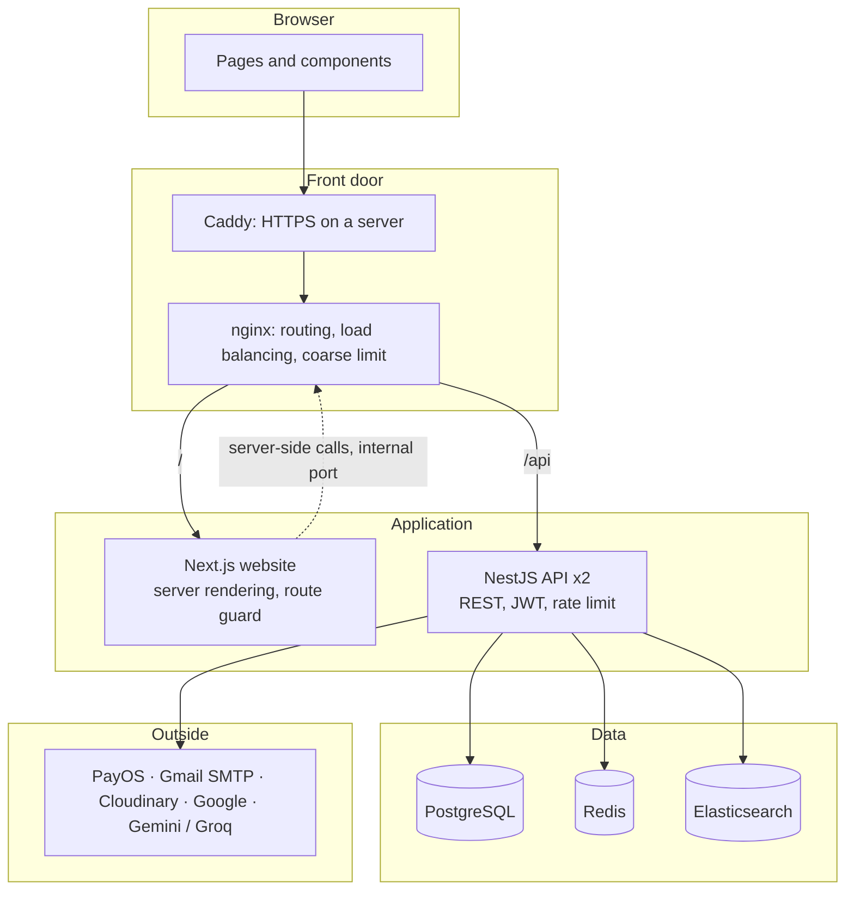
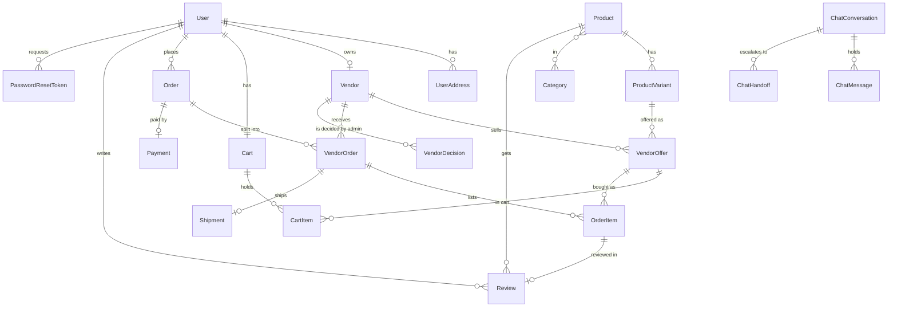
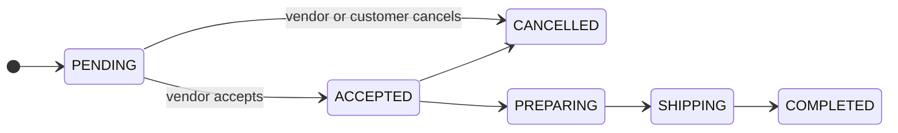

# Architecture

How the shop is built, and why. For how to run it see [deployment.md](deployment.md); for every setting see
[configuration.md](configuration.md).

## 1. The parts

| Part | Job |
|---|---|
| **Website** (`frontend/`) | Server-rendered pages and the browser app. A route guard (`src/proxy.ts`) sends visitors to the right page by role. It never decides who may see data: that is the API's job. |
| **API** (`backend/`) | All business rules. Two processes run side by side; they share nothing in memory, so every counter that must be shared lives in Redis. |
| **PostgreSQL** | The only store of record: accounts, catalogue, carts, orders, payments, reviews, chat history. |
| **Redis** | Rate limit counters, the catalogue cache, login lock-outs, "sign out everywhere" markers. Optional: without it each process keeps them in memory (correct for one process). |
| **Elasticsearch** | Product text search (typos, no accents, suggestions). Optional: without it, or while it is down, the shop searches in memory. |
| **nginx** | The one door: `/` goes to the website, `/api` to the API processes (re-resolved every 5 s, so a new container is found without a restart). It also holds a coarse per-address limit. |
| **Caddy** | On a server only: HTTPS certificates, then forwards to nginx. |

## 2. Request path

1. The browser asks `https://<site>/api/...`; Caddy forwards, nginx picks an API process.
2. Global guards run in this order: **rate limit** (per address, `@RateLimit` per route), **JWT** (`@Public()` skips it),
   then **roles** (`@Roles()`), which reads the account's role and status from the **database**, not from the token.
3. A validation pipe checks the body against the DTO class; unknown fields are refused.
4. The service does the work, usually in a database transaction; the controller returns a DTO.

## 3. Back-end modules

`backend/src/module/`, one folder per feature, each with controller, service, DTOs and a spec.

| Module | Responsibility |
|---|---|
| `auth` | Register, sign in, admin sign in, Google sign-in, password reset |
| `account` | Profile, password change, saved addresses |
| `product`, `category` | Catalogue listing, product detail, regions, search suggestions |
| `search` | Elasticsearch index and the in-memory fallback |
| `cart` | Server cart, guest quote and merge |
| `checkout` | Preview and place an order (idempotent, all or nothing) |
| `order` | Customer orders, status rules, cancel, buy again, order lifecycle |
| `payment` | PayOS QR links, webhook, payment status |
| `review` | Reviews (delivered purchases only) |
| `vendor` | Store profile, offers and products, order handling, statistics, applications, public store page, follow |
| `admin` | Vendor decisions, categories, accounts, statistics |
| `mail` | Sending mail and the templates |
| `chat` | The assistant "Cá Voi" (see section 9) |
| `smart-import`, `visual-search` | AI-assisted product drafts and search by photo |
| `administrative-unit` | Provinces, districts, wards |
| `common`, `infra` | Guards, decorators, shared store, rate limiter, cache, health |

## 4. Data model

The schema is in `backend/prisma/schema/*.prisma`, split by area, and every change is a committed SQL migration.
The main tables (columns trimmed):

Choices worth knowing:

- **A vendor sells an *offer*, not a product.** The catalogue (`Product`, `ProductVariant`) is shared; each vendor
  attaches a price and a stock to a variant (`VendorOffer`). The cart and the order point at offers.
- **One order, one part per vendor.** `Order` is what the customer sees; `VendorOrder` is what each vendor handles,
  with its own status and shipping fee. Prices and names are copied into `OrderItem` when the order is placed, so later
  edits never change history.
- **Deleting is restricted** where history matters (orders, reviews, vendor decisions use `onDelete: Restrict`), and
  cascades only for owned details (addresses, cart items, tokens).
- **Money** is `Decimal` and travels as a string in the API.

## 5. Who may do what

| Rule | How it is enforced |
|---|---|
| Three roles: `CUSTOMER`, `VENDOR`, `ADMIN` | `@Roles()` + `RolesGuard` (`@Admin()` shorthand) |
| The role is read **from the database on every request** | An approval opens the vendor area at once, a suspension closes it at once, and an old token cannot keep a role it lost |
| Another person's data answers **404, not 403** | Queries always include the owner (`userId`, `vendorId`), so order numbers and ids reveal nothing |
| A password reset **signs the account out everywhere** | The reset writes a timestamp to the shared store; the JWT guard refuses tokens issued before it |
| Admins sign in only on the admin endpoint, with a short token | `POST /auth/admin/login` answers every failure the same and locks an address after 5 failures for 15 minutes |
| Vendors and customers never use the admin endpoint, admins never use the customer one | Both refuse the other role |

The end-to-end suite checks these rules as a table (see [testing.md](testing.md)).

### Authentication flows

- **Email and password**: bcrypt hash; a JWT `{ sub, email, role }` (7 days; 2 hours for admins).
- **Forgot password**: a random token is mailed as a link; only its SHA-256 is stored; it works once for 30 minutes;
  the answer is the same whether or not the address has an account; one address gets 3 mails an hour.
- **Google**: the browser gets an ID token from Google; the API checks its signature, audience, expiry and
  `email_verified`. A password account whose mailbox was never proved **loses its password** when Google links to it,
  so whoever registered first cannot keep a way in.

## 6. Orders and payments

That is the life of one **vendor order** (one part). The customer's **order** status is derived from its parts: the
slowest part that is not cancelled decides (`PENDING`, `CONFIRMED`, `PROCESSING`, `SHIPPING`, `COMPLETED`); when every
part is cancelled the order is `CANCELLED`.

- **Checkout** (`POST /checkout`) needs an `Idempotency-Key` header. One transaction creates the order and its parts,
  takes the stock and fixes the prices; sending the same key again returns the same order. A shortage in one line
  stops the whole order.
- **Customer cancel** is allowed only while every live part is still `PENDING`; it restocks.
- **Cash on delivery**: payment is `PENDING` and becomes `PAID` when every live part is `COMPLETED`.
- **QR (PayOS)**: a payment link is made for the order (valid 15 minutes, can be made again). The vendor **cannot accept**
  until it is `PAID`. PayOS calls a signed webhook; the API verifies the signature and accepts only the full amount,
  once. The payment screen also asks PayOS directly, for when the webhook cannot reach the server.
- **Cancelling** a paid order records `REFUNDED` (no money is sent back through PayOS); cancelling an unpaid QR order
  marks it `FAILED` and closes the PayOS link.
- **Reviews**: only for an item of a `COMPLETED` part, once per item.

Payment statuses: `PENDING`, `PAID`, `FAILED`, `REFUNDED`, `CANCELLED`, `EXPIRED`.

## 7. Mail

`MailService` never holds up or breaks what a customer is doing: a mail is queued, retried twice, and a failure is only
logged (with the address masked). Mails: order confirmation (with the QR link while unpaid), payment received, shipped,
delivered, cancelled, password reset, password changed, Google linked. Without `SMTP_USER` the mails are written to the
API log, which is how the reset-password E2E test reads its link.

## 8. Search, cache and limits

Summarised here, measured and explained in [deployment.md](deployment.md).

- **Rate limits** are per address and per route, held in Redis so the two API processes count together. The login
  lock-out and the chatbot budget use the same store. If Redis fails, requests are let through (fail open).
- **Cache**: the catalogue listing and categories for 30 seconds; stock in the listing can be that much late, but the
  cart and checkout always read the real stock.
- **Search**: the words typed are matched in Elasticsearch; price and stock are never indexed, so they are always
  current. The index is rebuilt (into a new index, then switched in one step) when the API starts and after changes.

## 9. The assistant "Cá Voi"

The model never touches the database. It can only ask the API to run **tools** (`search_products`, `get_my_order`,
`list_my_recent_orders`, `search_knowledge`, `propose_add_to_cart`, `propose_reorder`, `remember_preference`,
`contact_support`). Live data (price, stock, order status) comes from tools that call the same services as the shop;
policies come from the help documents in `backend/knowledge/` (retrieval: vector similarity plus keywords). The customer
is identified by the token, never by the model, and "add to cart" is only a proposal the customer confirms.

Guardrails: a per-person rate limit and a daily budget, a maximum message length, masking of personal data in logs,
detection of takeover attempts (recorded as incidents), and an admin page for latency, tokens and incidents.
The model is behind one interface (`LlmProvider`): Gemini, Groq, or a mock for tests.

**Smart Import** (vendors describe a product by text or voice and get an editable draft) and **Visual Search**
(customers upload a photo) use Groq models. All three features are off until their key is set.

## 10. Website

- **App Router** pages in `frontend/src/app/`; each feature has its own folder in `src/features/` with components, API
  calls and types.
- **Route guard** `src/proxy.ts` reads two cookies (a hint, not a proof) to redirect a signed-out visitor to sign in
  (remembering where to come back to) and a visitor of the wrong role to `/unauthorized`. The API refuses a forged
  cookie anyway.
- **Session**: `AuthContext` keeps the token in `localStorage` (or `sessionStorage` without "remember me"), checks it with
  `GET /auth/me` on load, and signs out on any 401.
- **Admin on its own address** (optional): with `NEXT_PUBLIC_ADMIN_URL` set, `/admin` is served only there and the shop
  host answers "not found" for it.
- Server-rendered pages call the API through nginx's internal port (`API_INTERNAL_URL`), which is not counted in the
  per-address limit.

## 11. Security measures at a glance

| Area | Measure |
|---|---|
| Passwords | bcrypt; reset tokens stored as SHA-256, single use, 30 minutes |
| Sessions | short admin tokens; revocation on reset; role read from the database |
| Enumeration | same answer for unknown and known emails; admin failures all look alike; 404 for other people's data |
| Abuse | per-route rate limits, login lock-out, mail limit per address, chat budget |
| Input | DTO validation (whitelist), HTML escaping in mail templates, header-injection stripping in mail |
| Payment | webhook signature check, full amount only, idempotent |
| Orders | idempotency key, one transaction, stock taken atomically |
| Uploads | signed direct uploads to Cloudinary; the API never handles the files |
| Secrets | only in the server's `.env`; images contain none |
| Headers | HSTS and friends at Caddy; nginx strips a visitor's `X-Internal-Request` |
